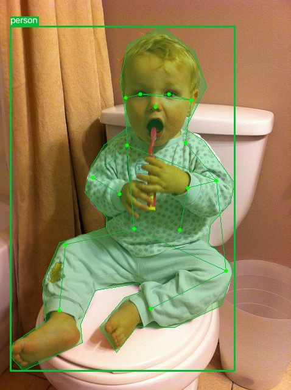

# DataFlow-CV

> 🌊 **Everything your model doesn't do.** Analyse, convert, visualize, evaluate — a single CLI for all CV data.

<p align="center">
  <a href="https://pypi.org/project/dataflow-cv/"></a>
  <a href="https://www.python.org/downloads/"></a>
  <a href="https://github.com/zjykzj/DataFlow-CV/actions/workflows/python-publish.yml"></a>
  <a href="LICENSE"></a>
  <a href="https://deepwiki.com/zjykzj/DataFlow-CV"></a>
  <br>
  
  
  
  
  
  
</p>

A computer vision dataset processing library — analyse, convert, visualize, and evaluate detection, segmentation, and pose (keypoint) annotations across YOLO, LabelMe, and COCO formats. Works with ground-truth labels and model predictions alike, from the CLI or Python API.

| | | |
|:---|:---|:---|
| 🔍 **Analyse** | Stats, train/val split, category filter, N-way partition & file sampling — format auto-detection | `dataflow-cv analyse stats ...` |
| 🔄 **Convert** | 6 directions: YOLO ↔ LabelMe ↔ COCO, plus model predictions | `dataflow-cv convert yolo2coco ...` |
| 🎨 **Visualize** | OpenCV rendering with color-coded classes, display & save modes | `dataflow-cv visualize yolo ...` |
| 📊 **Evaluate** | COCO mAP via pycocotools, single-threshold P/R/F1 per class | `dataflow-cv evaluate detection ...` |
| 📋 **Task Types** | Detection, segmentation & pose (keypoints) supported by all four modules across all three formats — det/seg auto-detected, pose explicit (`--pose`) | `dataflow-cv convert yolo2coco --pose ...` |
| 💻 **CLI + API** | Click-based CLI with rich `--help`; Python API for pipelines | `from dataflow.convert import ...` |
| 🤖 **AI Skills** | Claude Code skill (`/dataflow:dataflow-cv`) for AI assistants — CLI/API reference & known gotchas | `claude plugin install dataflow@claude-skills` |

---

## 📦 Installation

```bash
pip install dataflow-cv               # from PyPI
pip install dataflow-cv[coco]         # optional: COCO RLE + evaluation
```

Or from source:

```bash
git clone https://github.com/zjykzj/DataFlow-CV.git
cd DataFlow-CV && pip install .
```

---

## 🚀 Quick Start

### Command-line Interface

All required parameters (image directories, label directories, class files, output paths) are positional arguments for better usability. Use `--help` on any subcommand for detailed usage.

#### 📂 Data at a Glance

| Module | YOLO | LabelMe | COCO |
|--------|------|---------|------|
| 🔍 Analyse — stats / filter | ✓ | ✓ | ✓ |
| 🔍 Analyse — split / partition / sample | ✓ | ✓ | — |
| 🔄 Convert (6 directions) | ✓ | ✓ | ✓ |
| 🎨 Visualize | ✓ | ✓ | ✓ |
| 📊 Evaluate | — ¹ | — ¹ | ✓ |

¹ Evaluate always consumes COCO-format GT/DT JSON — convert other formats first (`yolo2coco`, `labelme2coco`).

| Task | YOLO (per-image `.txt`) | LabelMe (per-image `.json`) | COCO (single `.json`) | Enablement |
|------|-------------------------|-----------------------------|-----------------------|------------|
| 🔲 **Detection** | `class_id cx cy w h` | `rectangle` shape | `bbox` field | Automatic — no flag |
| ✂️ **Segmentation** | `class_id x1 y1 … xn yn` | `polygon` shape | `segmentation` field (polygon or RLE) | Automatic — no flag |
| 🦴 **Pose (keypoints)** | `class_id cx cy w h px1 py1 pv1 …` (5+3k tokens) | `point` shapes + one `rectangle` sharing a `group_id` | `keypoints` field + `categories[].keypoints`/`skeleton` | Explicit — `--pose` / `--kpts-config` |

**Essentials:**

- **Format auto-detection**: point at your labels — a single `.json` → COCO, a directory of `.txt` → YOLO, a directory of `.json` → LabelMe (see the [FAQ](docs/en/faq.md) for detection pitfalls).
- **YOLO labels must share the image's file name** (`labels/000001.txt` ↔ `images/000001.jpg`); coordinates are normalized [0,1].
- **`classes.txt`** (one class name per line — the line number is the class id) is **required** for `yolo2coco`, `yolo2labelme`, `labelme2yolo`, `labelme2coco`, `visualize yolo`; **auto-generated** by `coco2yolo` / `coco2labelme` (pass `-c` to control the order).
- **Detection and segmentation are auto-detected** — from row token count (YOLO), shape type (LabelMe), or field presence (COCO). **Pose is explicit**: a YOLO pose row cannot be told apart from a segmentation row by token count alone. Per-module flags: analyse `--kpts-config`, convert `--pose`, visualize `--pose` (YOLO), evaluate `keypoints` — details in the [CLI reference](docs/en/cli.md).
- 🦴 Pose datasets use a **keypoint-definition YAML** (`kpts.yaml` — names / skeleton / sigmas, X-AnyLabeling style): pass it with `--kpts-config`, or `--save-kpts-config` to export one from a COCO dataset.

#### 🔍 Dataset Analysis

```bash
# Statistics (auto-detects YOLO / LabelMe / COCO)
dataflow-cv analyse stats yolo_labels/ --image-dir images/ --class-file classes.txt

# Train / val split (YOLO / LabelMe — labels / images / both modes)
dataflow-cv analyse split -l yolo_labels/ -i images/ -c classes.txt --ratio 0.8 --seed 42 outputs/

# Category filter (keep a subset, remap IDs per the new classes.txt)
dataflow-cv analyse filter yolo_labels/ classes.txt classes_new.txt filtered/

# N-way partition / file sampling (YOLO / LabelMe)
dataflow-cv analyse partition -n 4 --label-dir yolo_labels/ --image-dir images/ parts/
dataflow-cv analyse sample -l yolo_labels/ output/ -n 10 --seed 42

# Pose: keypoint statistics (--kpts-config also enables YOLO pose-row parsing)
dataflow-cv analyse stats --kpts-config kpts.yaml yolo_pose_labels/
```

> Multiple paths, recursion, sorting and all options → [CLI reference](docs/en/cli.md)

#### 🔄 Format Conversion

```bash
# YOLO → COCO  (GT: label mode; DT: --prediction for model output)
dataflow-cv convert yolo2coco images/ yolo_labels/ classes.txt output.json
dataflow-cv convert yolo2coco --prediction images/ yolo_preds/ classes.txt pred.json

# COCO → YOLO / LabelMe  (outputs named by image file stem; classes.txt auto-generated)
dataflow-cv convert coco2yolo input.json yolo_labels/
dataflow-cv convert coco2labelme input.json labelme_json/

# LabelMe → YOLO
dataflow-cv convert labelme2yolo labelme_json/ classes.txt yolo_labels/

# Pose: add --pose to any of the six directions
dataflow-cv convert yolo2coco --pose --kpts-config kpts.yaml images/ yolo_pose_labels/ classes.txt pose.json
```

> All six directions (`yolo2labelme`, `labelme2coco` too), `--do-rle`, `--save-crowd`, pose variants and output-naming details → [CLI reference](docs/en/cli.md)

#### 🎨 Visualization

```bash
# Visualize YOLO / LabelMe / COCO annotations
dataflow-cv visualize yolo images/ yolo_labels/ classes.txt --save visualized/
dataflow-cv visualize labelme images/ labelme_json/ --save visualized/
dataflow-cv visualize coco images/ coco_annotations.json --save visualized/

# Pose: keypoints + skeleton rendering (v=2 filled green, v=1 hollow orange)
dataflow-cv visualize yolo --pose --kpts-config kpts.yaml images/ yolo_pose_labels/ classes.txt --save visualized/
dataflow-cv visualize coco images/ coco_pose.json --save visualized/   # skeleton from COCO categories
```

> Headless mode (`--no-display`), keyboard controls and all options → [CLI reference](docs/en/cli.md)

<p align="center">
  
  
</p>

#### 📊 Evaluation

Evaluate detection, segmentation, and pose models with COCO-standard metrics. Two COCO-format JSON files are required — GT (full COCO dict, `yolo2coco`) and DT (plain JSON list with `score`, `yolo2coco --prediction`):

```bash
# 1) Prepare: YOLO labels → GT, YOLO predictions → DT
dataflow-cv convert yolo2coco images/ yolo_labels/ classes.txt anno.json
dataflow-cv convert yolo2coco --prediction images/ yolo_preds/ classes.txt pred.json

# 2) Evaluate — detection (bbox IoU) / segmentation (mask IoU) / pose (OKS)
dataflow-cv evaluate detection anno.json pred.json
dataflow-cv evaluate segmentation anno.json pred.json
dataflow-cv evaluate keypoints --kpts-config kpts.yaml anno_pose.json pred_pose.json

# 3) Or quick single-threshold P/R/F1 instead of mAP
dataflow-cv evaluate detection --prf1 anno.json pred.json
```

> GT/DT field requirements per mode, `--prf1` options, `--output`, verbose mode → [CLI reference](docs/en/cli.md)

#### 🔄 End-to-End Workflow

The full pipeline from raw YOLO data to evaluation — the output of each step feeds the next:

```bash
# 0) Your data:  data/images/*.jpg  +  data/labels/*.txt (same file names)
#                +  classes.txt (one class name per line)

# 1) Inspect the dataset
dataflow-cv analyse stats data/labels/ --image-dir data/images/ --class-file classes.txt

# 2) Split into train / val          → data/split/train/ + data/split/val/
dataflow-cv analyse split -l data/labels/ -i data/images/ -c classes.txt \
    --ratio 0.8 --seed 42 data/split/

# 3) Val labels → COCO ground truth  (GT and DT must cover the SAME images —
#    evaluate your model on the val set)
dataflow-cv convert yolo2coco data/split/val/images/ data/split/val/labels/ \
    classes.txt gt.json

# 4) Model predictions on the val set → COCO detections
#    (prediction files carry confidence — 6 tokens for detection)
dataflow-cv convert yolo2coco --prediction data/split/val/images/ preds/ \
    classes.txt pred.json

# 5) Evaluate (mAP, or quick P/R/F1)
dataflow-cv evaluate detection gt.json pred.json
dataflow-cv evaluate detection --prf1 --output prf1.json gt.json pred.json

# 6) Spot-check the val set visually
dataflow-cv visualize yolo --no-display data/split/val/images/ data/split/val/labels/ \
    classes.txt --save viz/
```

### 🐍 Python API

Every CLI capability is also available as a Python API — see the full reference in the manual: **[docs/en/api.md](docs/en/api.md)** (中文手册: **[docs/zh/api.md](docs/zh/api.md)**).

```python
from dataflow.analyse import StatsAnalyser
from dataflow.convert import YoloAndCocoConverter

stats = StatsAnalyser().analyse("yolo_labels/", class_file="classes.txt")
print(f"{stats.data.total_files} images, {stats.data.total_annotations} objects")

YoloAndCocoConverter(source_to_target=True).convert(
    source_path="yolo_labels/", target_path="anno.json",
    class_file="classes.txt", image_dir="images/",
)
```

> 📂 Complete examples: the `samples/` directory — `samples/analyse/`, `samples/convert/` (6 directions), `samples/visualize/` (YOLO, LabelMe, COCO), `samples/evaluate/` (detection, segmentation & keypoints), `samples/cli/` (CLI workflows).

### 🤖 AI Assistant Skills

We maintain a dedicated Claude Code skill for dataflow-cv — `/dataflow:dataflow-cv` — so LLMs and AI agents can operate its CLI and Python API correctly in any project. The skill covers:

- **CLI command tree and task mapping**: 17 subcommands across analyse / convert / visualize / evaluate
- **Python API reference**: handlers (incl. pose `Keypoints`), analysers, converters, visualizers, evaluators
- **Canonical example commands** and **known gotchas** (coordinate semantics, prediction formats, RLE encoding, …)

Install once per machine:

```bash
claude plugin install dataflow@claude-skills
```

Once installed, AI assistants load the skill on demand when working on dataset conversion, evaluation, or similar tasks — it can also be invoked explicitly via `/dataflow:dataflow-cv`. The library works normally without it.

---

## 📖 Documentation

| Resource | Description |
|----------|-------------|
| **[CLAUDE.md](CLAUDE.md)** | Architecture overview, development guide, and known gotchas |
| **[CHANGELOG.md](CHANGELOG.md)** | Version history and breaking changes |
| **[CONTRIBUTING.md](CONTRIBUTING.md)** | Contribution workflow, spec-first rules, quality gates |
| **[docs/en/](docs/en/)** | English user manual — CLI & Python API references, FAQ |
| **[docs/zh/](docs/zh/)** | 中文用户手册 — CLI 与 Python API 参考、FAQ |
| **[specs/evaluate/](specs/evaluate/)** | Evaluation metric contracts — IoU, matching, AP/mAP/AR |
| **[specs/formats/](specs/formats/)** | External format contracts — YOLO, LabelMe, COCO, conversion rules |
| **[specs/modules/](specs/modules/)** | Internal module architecture, interface contracts, dependency constraints |

### 💡 Key Concepts

- **Format-Native Coordinates**: YOLO uses normalized [0,1] center-based coordinates; LabelMe and COCO use absolute pixel top-left. There is no hidden internal normalization — check `DatasetAnnotations.format` to interpret coordinate semantics.
- **Strict Mode** (default): Validation errors raise exceptions immediately. Disable with `--no-strict` (CLI) or `strict_mode=False` (API) to skip invalid annotations and continue.
- **Verbose Logging**: `--verbose` enables per-module file logging via `LogManager` — console shows INFO-level progress, log files capture DEBUG details. All logging is owned by modules; the CLI uses `click.echo()` for terminal output.
- **Headless Support**: Use `--no-display` for servers/Docker — pair with `--save` to render visualization images without a GUI window.
- **Keyboard Shortcuts** (visualization): `←` / `↑` for previous, `→` / `↓` / `Enter` / `Space` for next, `s` to save snapshot, `h` to show hints, `q` / `ESC` to exit. First/last-image boundaries are no-ops. Title bar shows `[N/T]` position.
- **Evaluation**: `--prf1` computes P/R/F1 only (single-threshold, per-class TP/FP/FN) — skips the full COCOeval mAP pipeline for speed. Supports macro/micro averaging and bbox/mask IoU. Run without `--prf1` for standard COCO mAP. For both metrics, run twice.
- **Prediction Files**: YOLO predictions use 6 tokens (detection) or even tokens (segmentation) vs 5/odd for labels. Use `--prediction` with `yolo2coco` — outputs a plain JSON list of annotation dicts compatible with pycocotools `loadRes()`.
- **Pose (Keypoints)**: Pose rows are explicit (`--pose`) — token counts can collide with segmentation rows, so auto-detection is unsafe. Keypoint visibility is `v ∈ {0,1,2}`: 0 = not labeled (stored at 0,0), 1 = labeled but occluded, 2 = labeled and visible. COCO `num_keypoints` is recomputed on write; the keypoint-definition YAML carries names/skeleton/sigmas.

---

## 🔧 Development

For detailed developer guidance including advanced test commands, debugging, and architecture overview, see [CLAUDE.md](CLAUDE.md). Optional Claude Code skills for common tasks (`/maestro:spec`, `/maestro:commit`, `/maestro:release`, `/maestro:claude`) are available via the [maestro plugin](https://github.com/zjykzj/claude-skills) — the project develops normally without them.

### 🧪 Testing

**757 tests, 81% code coverage (6784 statements).**

```bash
pytest                                    # All tests
pytest --cov=dataflow --cov-report=term   # With coverage
pytest tests/convert/test_yolo_and_coco.py  # Single module
pytest tests/evaluate/test_evaluator.py     # Single module
```

<details>
<summary><b>📊 Coverage by module</b></summary>

| Module | Coverage | Highlights |
|--------|:--------:|------------|
| `dataflow/label/` | 73% | models (88%), utils (86%), base (84%), coco_handler (75%), labelme_handler (73%), yolo_handler (64%) |
| `dataflow/analyse/` | 85% | base (99%), log_templates (94%), sample (88%), split (88%), stats (86%), utils (84%), partition (79%), filter (76%) |
| `dataflow/convert/` | 86% | base (88%), labelme_and_yolo (87%), yolo_and_coco (87%), coco_and_labelme (86%), utils (86%), log_templates (85%), rle (80%) |
| `dataflow/visualize/` | 82% | yolo_vis (100%), coco_vis (91%), labelme_vis (90%), base (79%) |
| `dataflow/evaluate/` | 91% | log_templates (100%), result (100%), evaluator (98%), base (92%), utils (89%), metrics (87%) |
| `dataflow/cli/` | 72% | main (96%), utils (88%), visualize cmd (87%), analyse cmd (71%), evaluate cmd (66%), convert cmd (64%) |
| `dataflow/util/` | 100% | logging (100%) |

</details>

### 🎨 Code Quality

```bash
pip install -e .[dev]                       # Install dev dependencies
ruff check dataflow tests samples           # Lint
ruff format --check dataflow tests samples  # Format check
mypy dataflow                               # Type check
```

### 🔗 Pre-commit Hooks (Optional)

```bash
pip install pre-commit
pre-commit install            # Install git hooks (run once)

# After this, every `git commit` auto-runs:
#   ruff (lint, auto-fix) → ruff format → whitespace checks

pre-commit run --all-files    # Manual run against all files
```

### 📁 Project Structure

```
dataflow/
├── label/           # Annotation handlers + data models
├── analyse/         # Dataset stats, train/val split, category filter, N-way partition, file sampling
├── convert/         # Format converters, RLE utility, log templates
├── visualize/       # OpenCV-based rendering, log templates
├── evaluate/        # pycocotools-based metrics, log templates
├── util/            # Unified logging (LogManager + format helpers)
└── cli/             # CLI entry point, commands, validation
tests/               # Unit & integration tests (757 tests, conftest fixtures)
samples/             # Python API usage examples (analyse, convert, visualize, evaluate, cli)
assets/              # Test data (det/seg by format)
specs/               # Canonical specifications (evaluate/ + formats/ + modules/)
```

---

## 🤝 Contributing

Contributions are welcome! See [CONTRIBUTING.md](CONTRIBUTING.md) for the workflow, spec-first rules, quality gates, and conventions.

---

## 📄 License

This project is licensed under the MIT License — see [LICENSE](LICENSE) for details.

---

## 🙏 Acknowledgments

- Thanks to the creators of YOLO, LabelMe, and COCO formats for establishing these annotation standards
- Built with [OpenCV](https://opencv.org/), [NumPy](https://numpy.org/), [Click](https://click.palletsprojects.com/), and [pycocotools](https://github.com/cocodataset/cocoapi)
- Inspired by the need for seamless format conversion in multi-tool CV pipelines
