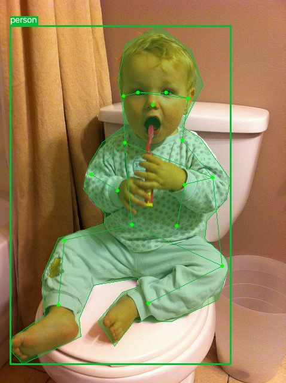
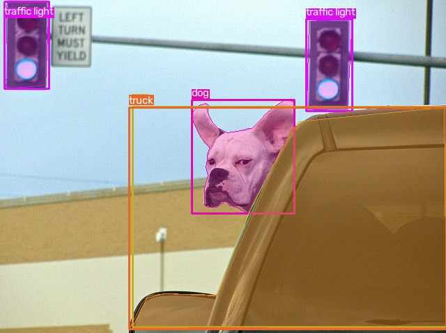

# DataFlow-CV

> 🌊 **模型以外的事,我们来做。** 分析、转换、可视化、评估 —— 一个 CLI 搞定所有 CV 数据处理。

<p align="center">
  <a href="https://pypi.org/project/dataflow-cv/"></a>
  <a href="https://www.python.org/downloads/"></a>
  <a href="https://github.com/zjykzj/DataFlow-CV/actions/workflows/python-publish.yml"></a>
  <a href="LICENSE"></a>
  <a href="https://deepwiki.com/zjykzj/DataFlow-CV"></a>
  <br>
  
  
  
  
  
  
</p>

DataFlow-CV 是一个计算机视觉数据集处理库 —— 在 YOLO、LabelMe 和 COCO 三种格式之间,对检测、分割与姿态(关键点)标注进行分析、转换、可视化和评估。真实标注与模型预测文件均支持,可通过 CLI 或 Python API 使用。

| | | |
|:---|:---|:---|
| 🔍 **分析** | 统计、训练/验证集划分、类别过滤、N 路分区与文件抽样 —— 格式自动检测 | `dataflow-cv analyse stats ...` |
| 🔄 **转换** | 6 个方向:YOLO ↔ LabelMe ↔ COCO,外加模型预测文件 | `dataflow-cv convert yolo2coco ...` |
| 🎨 **可视化** | OpenCV 渲染、按类别着色,支持显示与保存模式 | `dataflow-cv visualize yolo ...` |
| 📊 **评估** | 基于 pycocotools 的 COCO mAP、按类别的单阈值 P/R/F1 | `dataflow-cv evaluate detection ...` |
| 📋 **任务类型** | 四个模块 × 三种格式均支持检测、分割与姿态(关键点)—— det/seg 自动识别,姿态显式开启(`--pose`) | `dataflow-cv convert yolo2coco --pose ...` |
| 💻 **CLI + API** | 基于 Click 的 CLI,带丰富的 `--help`;Python API 用于构建流水线 | `from dataflow.convert import ...` |
| 🤖 **AI 助手技能** | 面向 AI 助手的 Claude Code 技能(`/dataflow:dataflow-cv`)—— CLI/API 参考与已知坑点 | `claude plugin install dataflow@claude-skills` |

---

## 📦 安装

```bash
pip install dataflow-cv               # 从 PyPI 安装
pip install dataflow-cv[coco]         # 可选:COCO RLE 编码 + 评估
```

或者从源码安装:

```bash
git clone https://github.com/zjykzj/DataFlow-CV.git
cd DataFlow-CV && pip install .
```

---

## 🚀 快速开始

### 命令行界面

所有必需参数(图像目录、标签目录、类别文件、输出路径)均为位置参数,使用更便捷。在任意子命令后使用 `--help` 查看详细用法。

#### 📂 数据速览

| 模块 | YOLO | LabelMe | COCO |
|--------|------|---------|------|
| 🔍 分析 —— 统计 / 类别过滤 | ✓ | ✓ | ✓ |
| 🔍 分析 —— 划分 / 分区 / 抽样 | ✓ | ✓ | — |
| 🔄 转换(6 个方向) | ✓ | ✓ | ✓ |
| 🎨 可视化 | ✓ | ✓ | ✓ |
| 📊 评估 | — ¹ | — ¹ | ✓ |

¹ 评估始终消费 COCO 格式的 GT/DT JSON —— 其他格式请先转换(`yolo2coco`、`labelme2coco`)。

| 任务 | YOLO(每图 `.txt`) | LabelMe(每图 `.json`) | COCO(单个 `.json`) | 启用方式 |
|------|-------------------------|-----------------------------|-----------------------|------------|
| 🔲 **检测** | `class_id cx cy w h` | `rectangle` shape | `bbox` 字段 | 自动 —— 无需 flag |
| ✂️ **分割** | `class_id x1 y1 … xn yn` | `polygon` shape | `segmentation` 字段(polygon 或 RLE) | 自动 —— 无需 flag |
| 🦴 **姿态(关键点)** | `class_id cx cy w h px1 py1 pv1 …`(5+3k 个 token) | `point` shapes + 一个共用 `group_id` 的 `rectangle` | `keypoints` 字段 + `categories[].keypoints`/`skeleton` | 显式 —— `--pose` / `--kpts-config` |

**要点:**

- **格式自动检测**:指向你的标签 —— 单个 `.json` → COCO,`.txt` 目录 → YOLO,`.json` 目录 → LabelMe(检测常见坑见 [FAQ](docs/zh/faq.md))。
- **YOLO 标签必须与图像同名**(`labels/000001.txt` ↔ `images/000001.jpg`);坐标归一化 [0,1]。
- **`classes.txt`**(每行一个类别名,行号即类别 id)**必需**于 `yolo2coco`、`yolo2labelme`、`labelme2yolo`、`labelme2coco`、`visualize yolo`;由 `coco2yolo` / `coco2labelme` **自动生成**(用 `-c` 控制顺序)。
- **检测与分割自动识别** —— 按行 token 数(YOLO)、shape 类型(LabelMe)或字段有无(COCO)。**姿态是显式的**:仅凭 token 数无法区分 YOLO pose 行与分割行。各模块 flag:分析 `--kpts-config`、转换 `--pose`、可视化 `--pose`(YOLO)、评估 `keypoints` —— 详见 [CLI 参考](docs/zh/cli.md)。
- 🦴 Pose 数据集使用**关键点定义 YAML**(`kpts.yaml` —— 名称 / 骨架 / sigmas,X-AnyLabeling 风格):用 `--kpts-config` 传入,或用 `--save-kpts-config` 从 COCO 数据集导出一份。

#### 🔍 数据集分析

```bash
# 统计(自动检测 YOLO / LabelMe / COCO)
dataflow-cv analyse stats yolo_labels/ --image-dir images/ --class-file classes.txt

# 训练/验证集划分(仅 YOLO / LabelMe —— 标签 / 图像 / 两者模式)
dataflow-cv analyse split -l yolo_labels/ -i images/ -c classes.txt --ratio 0.8 --seed 42 outputs/

# 类别过滤(保留类别子集,按新的 classes.txt 重映射 ID)
dataflow-cv analyse filter yolo_labels/ classes.txt classes_new.txt filtered/

# N 路分区 / 文件抽样(仅 YOLO / LabelMe)
dataflow-cv analyse partition -n 4 --label-dir yolo_labels/ --image-dir images/ parts/
dataflow-cv analyse sample -l yolo_labels/ output/ -n 10 --seed 42

# Pose:关键点统计(--kpts-config 同时启用 YOLO pose 行解析)
dataflow-cv analyse stats --kpts-config kpts.yaml yolo_pose_labels/
```

> 多路径合并、递归、排序与全部选项 → [CLI 参考](docs/zh/cli.md)

#### 🔄 格式转换

```bash
# YOLO → COCO(GT:标注模式;DT 模型输出用 --prediction)
dataflow-cv convert yolo2coco images/ yolo_labels/ classes.txt output.json
dataflow-cv convert yolo2coco --prediction images/ yolo_preds/ classes.txt pred.json

# COCO → YOLO / LabelMe(输出按图片文件名主干命名;classes.txt 自动生成)
dataflow-cv convert coco2yolo input.json yolo_labels/
dataflow-cv convert coco2labelme input.json labelme_json/

# LabelMe → YOLO
dataflow-cv convert labelme2yolo labelme_json/ classes.txt yolo_labels/

# Pose:六个方向均可加 --pose
dataflow-cv convert yolo2coco --pose --kpts-config kpts.yaml images/ yolo_pose_labels/ classes.txt pose.json
```

> 全部六个方向(`yolo2labelme`、`labelme2coco` 等)、`--do-rle`、`--save-crowd`、pose 变体与输出命名细节 → [CLI 参考](docs/zh/cli.md)

#### 🎨 可视化

```bash
# 可视化 YOLO / LabelMe / COCO 标注
dataflow-cv visualize yolo images/ yolo_labels/ classes.txt --save visualized/
dataflow-cv visualize labelme images/ labelme_json/ --save visualized/
dataflow-cv visualize coco images/ coco_annotations.json --save visualized/

# Pose:关键点 + 骨架渲染(v=2 实心绿点,v=1 空心橙点)
dataflow-cv visualize yolo --pose --kpts-config kpts.yaml images/ yolo_pose_labels/ classes.txt --save visualized/
dataflow-cv visualize coco images/ coco_pose.json --save visualized/   # 骨架来自 COCO categories
```

> 无界面模式(`--no-display`)、键盘控制与全部选项 → [CLI 参考](docs/zh/cli.md)

<p align="center">
  
  
</p>

#### 📊 评估

用 COCO 标准指标评估检测、分割与姿态模型。需要两个 COCO 格式的 JSON 文件 —— GT(完整 COCO 字典,`yolo2coco`)与 DT(含 `score` 的纯 JSON 列表,`yolo2coco --prediction`):

```bash
# 1) 准备:YOLO 标注 → GT,YOLO 预测 → DT
dataflow-cv convert yolo2coco images/ yolo_labels/ classes.txt anno.json
dataflow-cv convert yolo2coco --prediction images/ yolo_preds/ classes.txt pred.json

# 2) 评估 —— 检测(bbox IoU)/ 分割(mask IoU)/ 姿态(OKS)
dataflow-cv evaluate detection anno.json pred.json
dataflow-cv evaluate segmentation anno.json pred.json
dataflow-cv evaluate keypoints --kpts-config kpts.yaml anno_pose.json pred_pose.json

# 3) 或快速单阈值 P/R/F1(替代 mAP)
dataflow-cv evaluate detection --prf1 anno.json pred.json
```

> 各模式的 GT/DT 字段要求、`--prf1` 系列选项、`--output`、verbose 模式 → [CLI 参考](docs/zh/cli.md)

#### 🔄 端到端工作流

从原始 YOLO 数据到评估的完整链路 —— 每一步的输出是下一步的输入:

```bash
# 0) 你的数据:data/images/*.jpg + data/labels/*.txt(同名文件)
#            + classes.txt(每行一个类别名)

# 1) 查看数据集统计
dataflow-cv analyse stats data/labels/ --image-dir data/images/ --class-file classes.txt

# 2) 划分训练/验证集                → data/split/train/ + data/split/val/
dataflow-cv analyse split -l data/labels/ -i data/images/ -c classes.txt \
    --ratio 0.8 --seed 42 data/split/

# 3) 验证集标签 → COCO 真值         (GT 与 DT 必须覆盖同一批图像 —— 在验证集上评估模型)
dataflow-cv convert yolo2coco data/split/val/images/ data/split/val/labels/ \
    classes.txt gt.json

# 4) 模型在验证集上的预测 → COCO 检测结果
#    (预测文件带置信度 —— 检测行为 6 个 token)
dataflow-cv convert yolo2coco --prediction data/split/val/images/ preds/ \
    classes.txt pred.json

# 5) 评估(mAP,或快速 P/R/F1)
dataflow-cv evaluate detection gt.json pred.json
dataflow-cv evaluate detection --prf1 --output prf1.json gt.json pred.json

# 6) 可视化抽查验证集
dataflow-cv visualize yolo --no-display data/split/val/images/ data/split/val/labels/ \
    classes.txt --save viz/
```

### 🐍 Python API

每个 CLI 能力都有对应的 Python API —— 完整参考见手册:**[docs/zh/api.md](docs/zh/api.md)**。

```python
from dataflow.analyse import StatsAnalyser
from dataflow.convert import YoloAndCocoConverter

stats = StatsAnalyser().analyse("yolo_labels/", class_file="classes.txt")
print(f"{stats.data.total_files} images, {stats.data.total_annotations} objects")

YoloAndCocoConverter(source_to_target=True).convert(
    source_path="yolo_labels/", target_path="anno.json",
    class_file="classes.txt", image_dir="images/",
)
```

> 📂 完整示例见 `samples/` 目录:`samples/analyse/`、`samples/convert/`(6 个方向)、`samples/visualize/`(YOLO、LabelMe、COCO)、`samples/evaluate/`(检测、分割与关键点)、`samples/cli/`(CLI 工作流)。

### 🤖 AI 助手技能

我们为 dataflow-cv 创建了专用的 Claude Code 技能 —— `/dataflow:dataflow-cv`,让 LLM / AI Agent 在任意项目中都能正确调用它的 CLI 与 Python API。技能内容涵盖:

- **CLI 命令树与任务映射**:analyse / convert / visualize / evaluate 共 17 个子命令
- **Python API 参考**:handlers(含 pose `Keypoints`)、analysers、converters、visualizers、evaluators
- **权威示例命令**与**已知坑点**(坐标语义、预测格式、RLE 编码等)

安装(每台机器一次):

```bash
claude plugin install dataflow@claude-skills
```

安装后,AI 助手在处理数据集转换、评估等任务时会按需自动加载该技能,也可通过 `/dataflow:dataflow-cv` 显式调用。未安装时不影响库本身的正常使用。

---

## 📖 文档

| 资源 | 说明 |
|----------|-------------|
| **[CLAUDE.md](CLAUDE.md)** | 架构概述、开发指南与已知坑点 |
| **[CHANGELOG.md](CHANGELOG.md)** | 版本历史与破坏性变更 |
| **[CONTRIBUTING.md](CONTRIBUTING.md)** | 贡献流程、规范优先规则、质量门禁 |
| **[docs/en/](docs/en/)** | 英文用户手册 —— CLI 与 Python API 参考、FAQ |
| **[docs/zh/](docs/zh/)** | 中文用户手册 —— CLI 与 Python API 参考、FAQ |
| **[specs/evaluate/](specs/evaluate/)** | 评估指标契约 —— IoU、匹配、AP/mAP/AR |
| **[specs/formats/](specs/formats/)** | 外部格式契约 —— YOLO、LabelMe、COCO、转换规则 |
| **[specs/modules/](specs/modules/)** | 内部模块架构、接口契约、依赖约束 |

### 💡 关键概念

- **格式原生坐标**:YOLO 使用归一化 [0,1] 中心点坐标;LabelMe 和 COCO 使用绝对像素左上角坐标。内部没有隐藏的归一化处理 —— 请查看 `DatasetAnnotations.format` 以理解坐标语义。
- **严格模式**(默认):验证错误立即抛出异常。通过 `--no-strict`(CLI)或 `strict_mode=False`(API)关闭后,将跳过无效标注并继续处理。
- **详细日志**:`--verbose` 通过 `LogManager` 启用各模块的文件日志 —— 控制台显示 INFO 级进度,日志文件记录 DEBUG 级细节。所有日志均由模块产生;CLI 使用 `click.echo()` 输出终端信息。
- **无界面支持**:服务器/Docker 环境使用 `--no-display` —— 搭配 `--save` 即可在无 GUI 窗口的情况下渲染可视化图像。
- **键盘快捷键**(可视化):`←` / `↑` 上一张,`→` / `↓` / `Enter` / `Space` 下一张,`s` 保存快照,`h` 显示帮助,`q` / `ESC` 退出。首尾边界操作为空操作。标题栏显示 `[N/T]` 位置。
- **评估**:`--prf1` 仅计算 P/R/F1(单阈值、按类别 TP/FP/FN)—— 跳过完整的 COCOeval mAP 流程以获得更快的速度。支持 macro/micro 平均以及 bbox/mask IoU。不加 `--prf1` 即计算标准 COCO mAP。如需两种指标,运行两次。
- **预测文件**:YOLO 预测文件检测任务每行 6 个 token、分割任务为偶数个 token,而标注文件为 5 个/奇数个。对 `yolo2coco` 使用 `--prediction` —— 输出纯 JSON 列表格式的标注字典,与 pycocotools `loadRes()` 兼容。
- **Pose(关键点)**:pose 行为显式模式(`--pose`)—— token 数可能与分割行冲突,自动检测不安全。关键点可见性 `v ∈ {0,1,2}`:0 = 未标注(存储为 0,0),1 = 已标注但被遮挡,2 = 已标注且可见。COCO `num_keypoints` 在写出时重新计算;关键点定义 YAML 承载名称/骨架/sigmas。

---

## 🔧 开发

详细的开发者指南(包括高级测试命令、调试和架构概述)见 [CLAUDE.md](CLAUDE.md)。常见任务的可选 Claude Code 技能(`/maestro:spec`、`/maestro:commit`、`/maestro:release`、`/maestro:claude`)可通过 [maestro 插件](https://github.com/zjykzj/claude-skills)获取——未安装时项目也能正常开发。

### 🧪 测试

**774 个测试,82% 代码覆盖率(6864 条语句)。**

```bash
pytest                                    # 全部测试
pytest --cov=dataflow --cov-report=term   # 带覆盖率报告
pytest tests/convert/test_yolo_and_coco.py  # 单个模块
pytest tests/evaluate/test_evaluator.py     # 单个模块
```

<details>
<summary><b>📊 各模块覆盖率</b></summary>

| 模块 | 覆盖率 | 亮点 |
|--------|:--------:|------------|
| `dataflow/label/` | 74% | models (88%), utils (86%), base (84%), coco_handler (75%), labelme_handler (73%), yolo_handler (64%) |
| `dataflow/analyse/` | 86% | base (99%), log_templates (94%), sample (89%), split (88%), stats (86%), utils (85%), partition (80%), filter (77%) |
| `dataflow/convert/` | 86% | base (88%), labelme_and_yolo (87%), yolo_and_coco (87%), coco_and_labelme (86%), utils (86%), log_templates (85%), rle (80%) |
| `dataflow/visualize/` | 83% | yolo_vis (100%), coco_vis (91%), labelme_vis (90%), base (79%) |
| `dataflow/evaluate/` | 91% | log_templates (100%), result (100%), evaluator (98%), base (92%), utils (88%), metrics (88%) |
| `dataflow/cli/` | 74% | main (96%), utils (88%), visualize cmd (87%), analyse cmd (71%), evaluate cmd (66%), convert cmd (64%) |
| `dataflow/util/` | 100% | logging (100%) |

</details>

### 🎨 代码质量

```bash
pip install -e .[dev]                     # 安装开发依赖
ruff check dataflow tests samples         # 代码检查
ruff format --check dataflow tests samples  # 格式检查
mypy dataflow                            # 类型检查
```

### 🔗 Pre-commit 钩子(可选)

```bash
pip install pre-commit
pre-commit install            # 安装 git 钩子(只需运行一次)

# 之后每次 `git commit` 会自动运行:
#   ruff(检查、自动修复)→ ruff format → 空白字符检查

pre-commit run --all-files    # 手动对全部文件运行
```

### 📁 项目结构

```
dataflow/
├── label/           # 标注处理器 + 数据模型
├── analyse/         # 数据集统计、训练/验证集划分、类别过滤、N 路分区、文件抽样
├── convert/         # 格式转换器、RLE 工具、日志模板
├── visualize/       # 基于 OpenCV 的渲染、日志模板
├── evaluate/        # 基于 pycocotools 的指标计算、日志模板
├── util/            # 统一日志(LogManager + 格式化辅助)
└── cli/             # CLI 入口、命令、校验
tests/               # 单元与集成测试(774 个测试、conftest 夹具)
samples/             # Python API 使用示例(analyse、convert、visualize、evaluate、cli)
assets/              # 测试数据(按格式分类的 det/seg)
specs/               # 权威规范(evaluate/ + formats/ + modules/)
```

---

## 🤝 贡献

欢迎贡献!贡献流程、规范优先规则、质量门禁与约定见 [CONTRIBUTING.md](CONTRIBUTING.md)。

---

## 📄 许可证

本项目采用 MIT 许可证 —— 详见 [LICENSE](LICENSE)。

---

## 🙏 致谢

- 感谢 YOLO、LabelMe 和 COCO 格式的创建者建立了这些标注标准
- 基于 [OpenCV](https://opencv.org/)、[NumPy](https://numpy.org/)、[Click](https://click.palletsprojects.com/) 和 [pycocotools](https://github.com/cocodataset/cocoapi) 构建
- 灵感来源于多工具 CV 流水线中对无缝格式转换的需求
